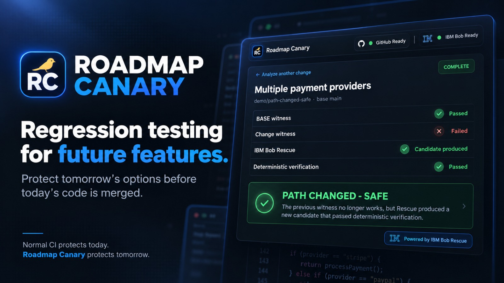

<p align="center">
  
</p>

<h1 align="center">Roadmap Canary</h1>

<p align="center">
  <strong>Regression testing for software you haven't built yet.</strong>
</p>

<p align="center">
  <a href="https://github.com/Farzine/roadmap-canary/actions"></a>
  <a href="https://www.python.org/downloads/"></a>
  <a href="LICENSE"></a>
</p>

---

Traditional CI tells you whether today's software still works. Roadmap Canary asks a second question:

> **Does this code change still leave a demonstrated viable path to a committed future capability?**

A refactor can keep every current test green while quietly making a planned feature much harder to build. Roadmap Canary makes that kind of regression visible.

## 🎯 The Problem

Engineering teams protect *existing* behavior with tests and CI. But they also make commitments about the *future* — multi-tenancy, multiple payment providers, enterprise SSO, offline mode, plugin support.

A "cleanup" PR today can silently remove the clean implementation path that made a roadmap item feasible. Normal CI has nothing to regress against because the future capability doesn't exist yet.

**Roadmap Canary fills that gap.**

## 🔬 How It Works

For each future capability the team wants to protect, Roadmap Canary keeps two things:

- A **human-approved Future Contract** defining what must remain possible, what evidence counts, protected tests/surfaces, and the allowed proof budget
- A **verified witness** — a small disposable executable proof that the capability is achievable from the current architecture

The witness is not the future product implementation. It only establishes a known-good path that future changes can be tested against.


```
committed future capability
          |
          v
human-approved Future Contract
          +
verified disposable witness
          |
          v
BASE replay -------- PR replay
                       |
                  witness fails
                       |
                 bounded Rescue
                       |
                    IBM Bob
                       |
                candidate proof
                       |
          deterministic verification
                 /             \
     PATH CHANGED - SAFE    ROADMAP RISK
```

The central trust boundary is:

> **Bob proposes. Roadmap Canary verifies.**

IBM Bob may search for a replacement path when the known witness stops working, but Bob never decides the final result. Roadmap Canary independently checks the candidate using the approved verification commands, BASE-anchored protected verifier inputs, and proof budget.

## 📊 Result Semantics

| Status | Meaning |
|--------|---------|
| **SAFE** | The known executable path still verifies on the proposed change |
| **PATH CHANGED - SAFE** | The known path disappeared, but Rescue produced another path that passed deterministic verification |
| **ROADMAP RISK** | The known path disappeared and no Rescue candidate passed verification within the bounded attempt |
| **STALE** | The Canary cannot be attributed to the proposed change (e.g., witness already fails on BASE) |

> `ROADMAP RISK` does not mean the future capability is impossible. It means the previously demonstrated low-cost path is no longer established under the approved constraints.

## 🚀 Quick Start

### Prerequisites

- Python 3.11+
- Git
- [IBM Bob Shell](https://docs.bob.ai/) (for Rescue functionality)

### Installation

```bash
git clone https://github.com/Farzine/roadmap-canary.git
cd roadmap-canary

python -m venv .venv
source .venv/bin/activate
pip install -e '.[dev]'
```

### Set Up IBM Bob (Optional — Required for Rescue)

```bash
export BOB_API_KEY="YOUR_BOB_API_KEY"
```

> **Note:** Keep API keys out of source control. Use `.env` files (already in `.gitignore`).

### Launch the UI

```bash
roadmap-canary ui
```

The UI opens at `http://127.0.0.1:8765`. It accepts a repository in `owner/repo` form. Public target repositories are cloned over HTTPS. Private repositories require suitable Git credentials, or you can use **Use local repository**.

## 🎬 Demo Video

Watch Roadmap Canary in action — detecting roadmap regressions and running bounded IBM Bob Rescue:

https://github.com/user-attachments/assets/731ff2df-4906-485d-9db3-7d29521f756e

<details>
<summary><b>📺 Watch Extended Live Demo Session</b></summary>

https://github.com/user-attachments/assets/ec157a6c-27ae-47f9-94fa-489685053fcd

</details>

## 🧪 Demo Scenarios

Use the prepared demo repository to see Roadmap Canary in action:

```
Repository:        kawchar85/roadmap-canary-demo
Future capability: Multiple payment providers
Base:              main
```

### Demo A: Path Changed, Future Preserved

```
Change: demo/path-changed-safe
```

| Step | Result |
|------|--------|
| BASE witness | ✅ PASS |
| PR witness | ❌ FAIL |
| IBM Bob Rescue | ✅ PASS |
| Deterministic verification | ✅ PASS |
| **Final Result** | **PATH CHANGED - SAFE** |

The original implementation path disappeared, but Bob found another small path satisfying the same Future Contract and proof budget.

### Demo B: Roadmap Risk

```
Change: demo/roadmap-risk
```

| Step | Result |
|------|--------|
| BASE witness | ✅ PASS |
| PR witness | ❌ FAIL |
| IBM Bob Rescue | ⚠️ Candidate produced |
| Deterministic verification | ❌ FAIL |
| **Final Result** | **ROADMAP RISK** |

The candidate satisfies functional checks but exceeds the approved proof budget — demonstrating that today's software can remain green while a committed future capability becomes materially more expensive to preserve.

## Establishing a Future Capability

A capability becomes an active Canary only after a baseline has been proven:

1. Define and approve the Future Contract.
2. Prepare a minimal witness on a separate Git ref.
3. Capture it with Roadmap Canary.
4. Roadmap Canary replays the witness on a clean BASE worktree and accepts it only if deterministic verification passes.

```bash
roadmap-canary capture \
  --repo /path/to/target-repo \
  --contract examples/issue-1/contract.yaml \
  --base main \
  --witness canary/multi-provider-witness \
  --output /path/to/target-repo/.roadmap-canary/issue-1
```

The resulting Canary artifact:

```
.roadmap-canary/
  issue-1/
    contract.yaml
    witness.patch
    metadata.json
    evidence.json
```

## ⚡ CLI Reference

### Validate a Future Contract

```bash
roadmap-canary validate examples/issue-1/contract.yaml
```

### Check Known Path (Without Rescue)

```bash
roadmap-canary check-known-path \
  --repo /path/to/target-repo \
  --canary /path/to/target-repo/.roadmap-canary/issue-1 \
  --base main \
  --pr <change-ref>
```

### Full Check with IBM Bob Rescue

```bash
roadmap-canary check \
  --repo /path/to/target-repo \
  --canary /path/to/target-repo/.roadmap-canary/issue-1 \
  --base main \
  --pr <change-ref> \
  --bob-max-turns 30 \
  --bob-max-cost 1.50 \
  --bob-timeout 900 \
  --output-dir ./run-evidence
```

### Promote a Verified Rescue

A successful Rescue does not automatically replace the trusted witness. After human review, promote it explicitly:

```bash
roadmap-canary promote \
  --repo /path/to/target-repo \
  --canary /path/to/target-repo/.roadmap-canary/issue-1 \
  --run-dir ./run-evidence
```

## 📁 Project Structure

```
roadmap-canary/
├── src/roadmap_canary/        # Core Python package
│   ├── cli.py                 # Typer CLI application
│   ├── contracts.py           # Future Contract loading & validation
│   ├── models.py              # Pydantic data models
│   ├── capture.py             # Witness capture pipeline
│   ├── replay.py              # BASE/PR witness replay
│   ├── evaluation.py          # Full evaluation orchestrator
│   ├── rescue.py              # IBM Bob Rescue agent adapter
│   ├── verifier.py            # Deterministic verification engine
│   ├── promote.py             # Witness promotion after Rescue
│   ├── worktree.py            # Isolated Git worktree management
│   ├── artifacts.py           # Canary artifact I/O
│   ├── runs.py                # Run evidence persistence
│   ├── ui.py                  # FastAPI web interface
│   └── static/index.html      # Single-page UI
├── tests/                     # Pytest test suite
├── docs/
│   ├── future-contract.md     # Trust boundary & evidence model
│   ├── bob-integration.md     # IBM Bob integration details
│   ├── ui.md                  # UI documentation
│   ├── design/                # Technical specification (LaTeX)
│   └── hackathon/             # Pitch decks, screenshots, videos
├── examples/
│   └── issue-1/contract.yaml  # Example Future Contract
├── .github/workflows/ci.yml   # GitHub Actions CI
├── pyproject.toml              # Project metadata & dependencies
├── LICENSE                     # MIT License
└── CONTRIBUTING.md             # Contribution guidelines
```

## 🔒 Proof Fidelity

Roadmap Canary does not ask an LLM whether a proof "looks realistic." Proof quality is encoded in the human-approved Future Contract through:

- **Verification commands** — approved tests, type checks, builds
- **Protected tests** — contents hashed before speculative work, must remain unchanged
- **Proof budgets** — constrained changed files, added lines, new dependencies
- **Real-path requirements** — backed by executable tests in the contract

See [`docs/future-contract.md`](docs/future-contract.md) for the full trust boundary and evidence model.

## 🤖 IBM Bob Integration

Roadmap Canary uses IBM Bob Shell in a bounded, isolated Rescue worktree. Rescue can be constrained by:

- Maximum turns
- Bobcoin cost limit
- Wall-clock timeout

Bob task metadata and the candidate patch are retained as run evidence when available.

See [`docs/bob-integration.md`](docs/bob-integration.md) for integration details.

## 🛠️ Development

```bash
python -m venv .venv
source .venv/bin/activate
pip install -e '.[dev]'
pytest
```

## 🏆 Hackathon

This project was built during the **IBM Bob 2.0 Hackathon** (September 2026). See [`docs/hackathon/`](docs/hackathon/) for pitch decks, demo videos, and screenshots.

## 📄 License

[MIT](LICENSE) — see [LICENSE](LICENSE) for details.
