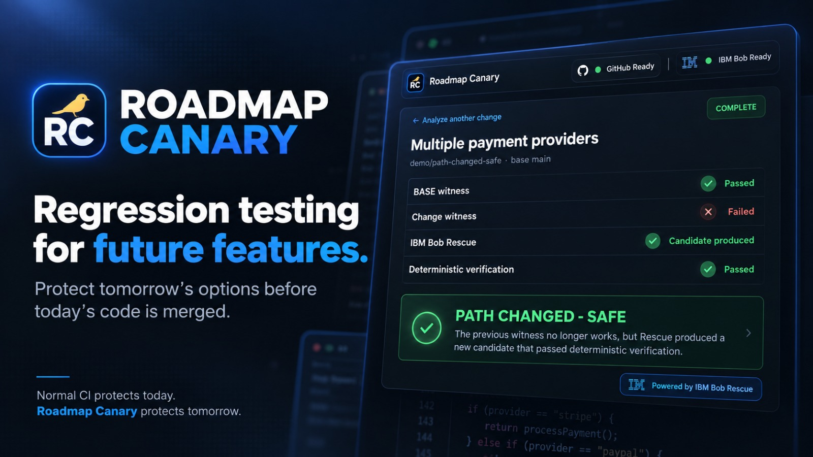
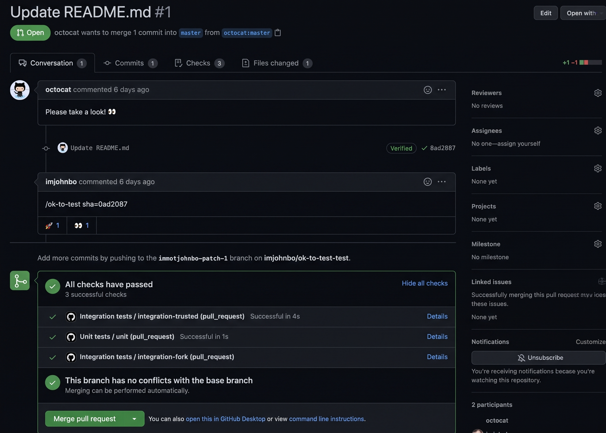
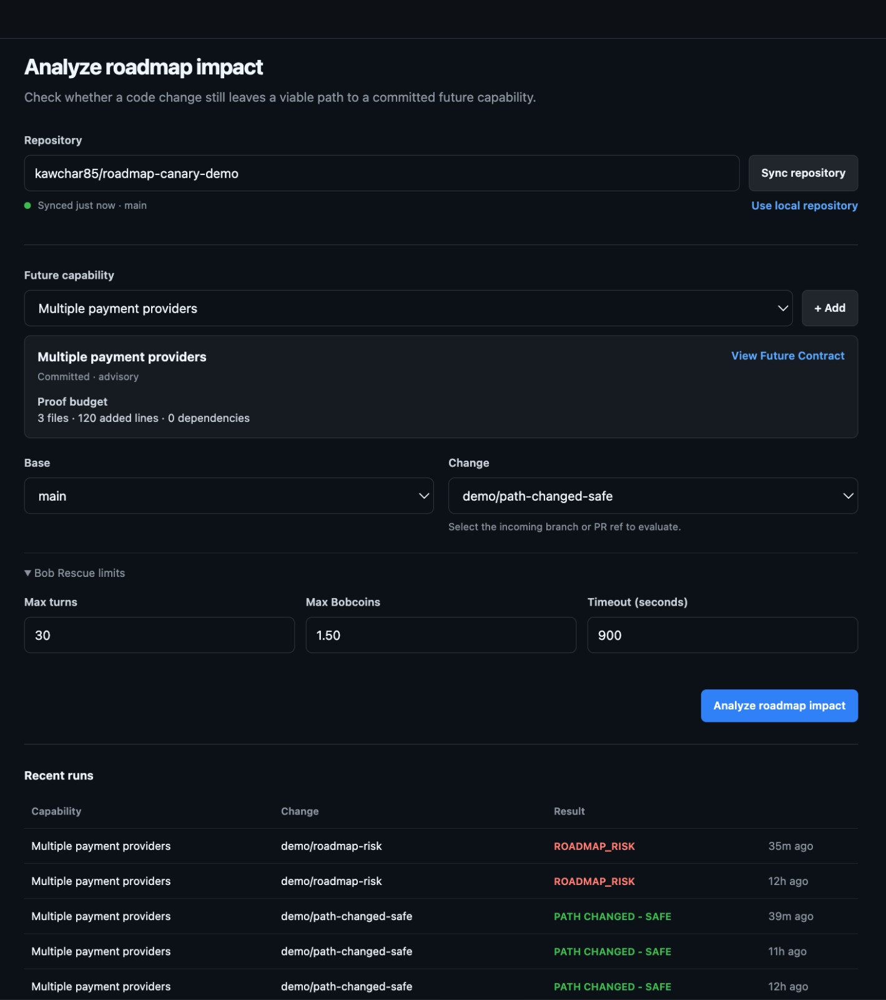
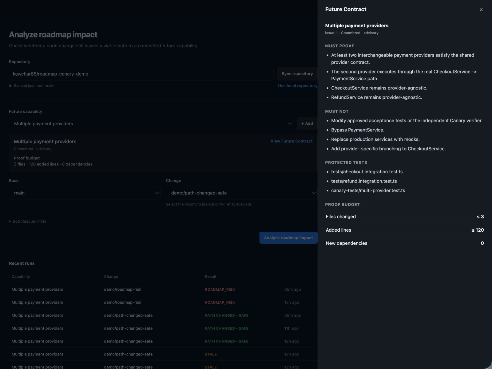
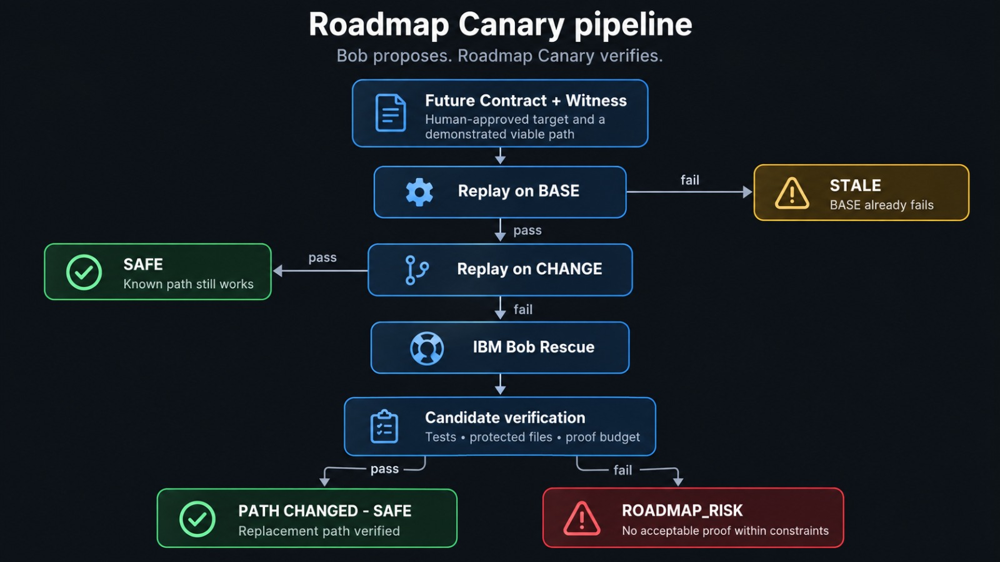
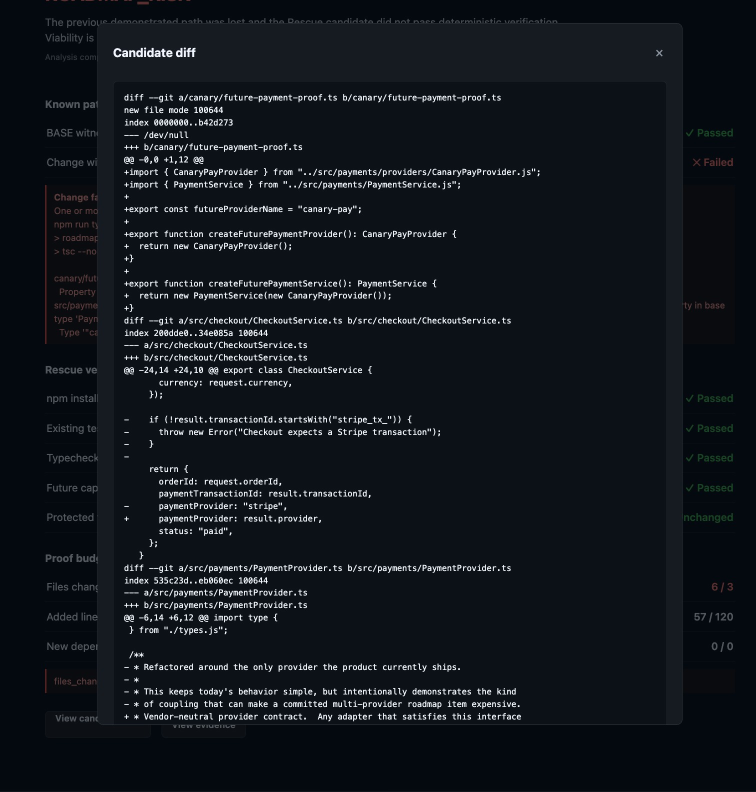
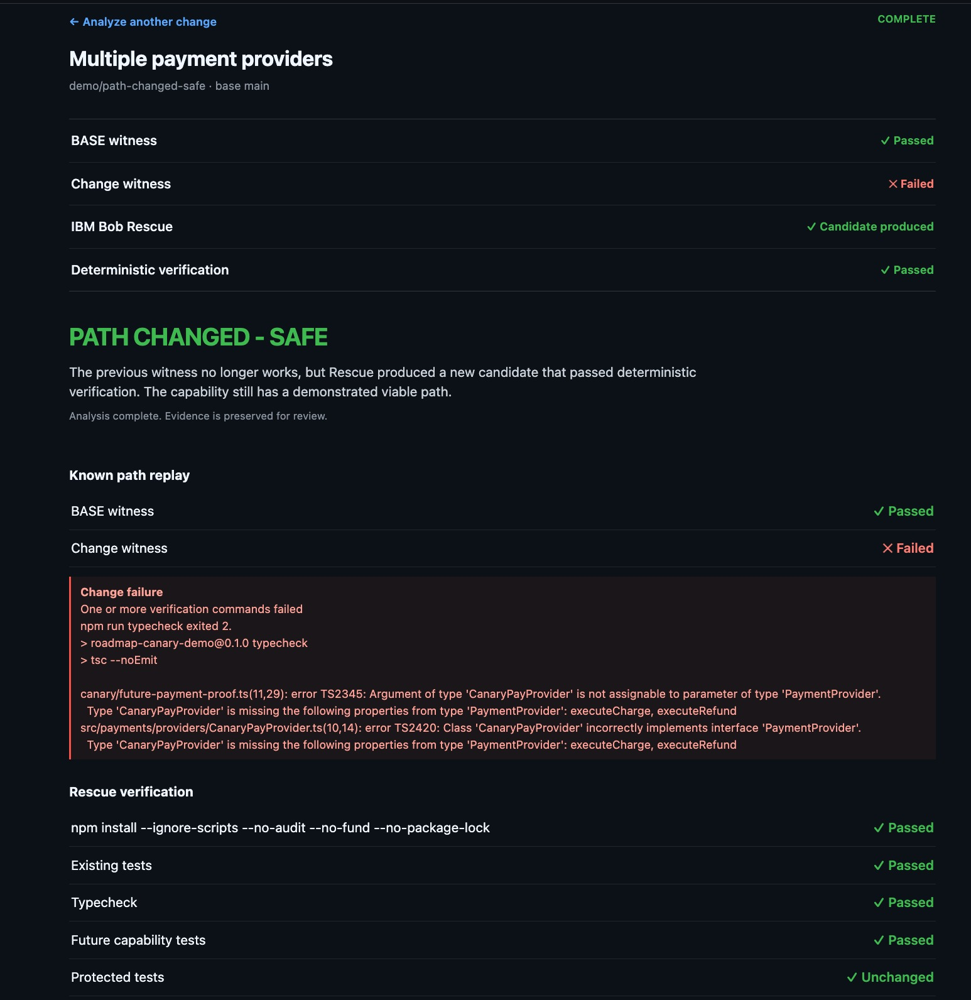
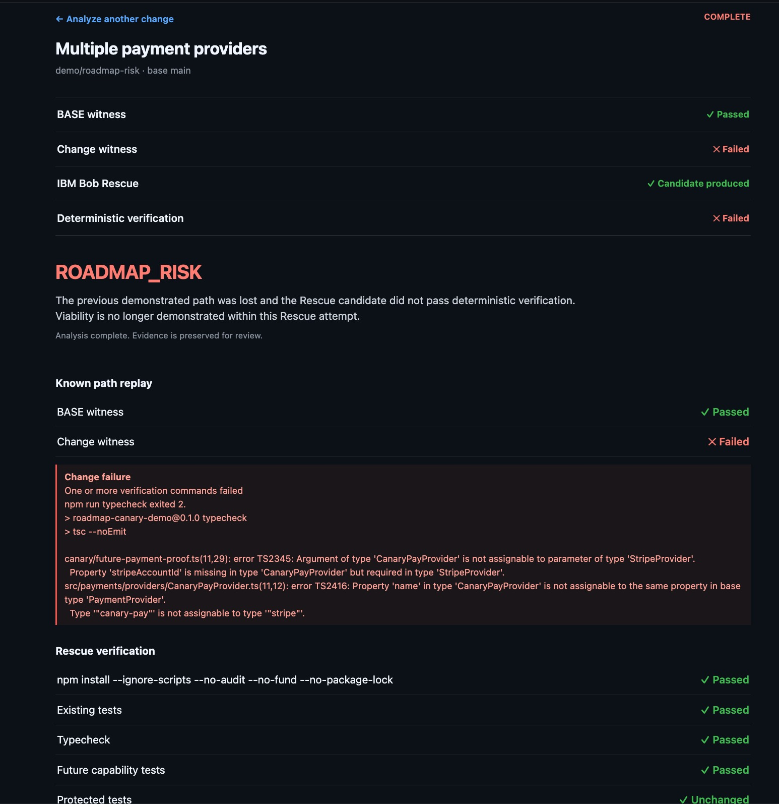

# Hackathon Materials

Roadmap Canary was built during the **IBM Bob 2.0 Hackathon** (September 2026).

## Presentations

| File | Description |
|------|-------------|
| [Roadmap_Canary_Pitch_v3.pdf](presentations/Roadmap_Canary_Pitch_v3.pdf) | Final pitch deck (PDF) |
| [Roadmap_Canary_Pitch_v3.pptx](presentations/Roadmap_Canary_Pitch_v3.pptx) | Final pitch deck (PowerPoint) |
| [Roadmap Canary — Pitch Deck.pptx](presentations/Roadmap%20Canary%20—%20Pitch%20Deck.pptx) | Presentation slides |

## Demo Videos

### Pitch & Walkthrough Video
https://github.com/user-attachments/assets/731ff2df-4906-485d-9db3-7d29521f756e

### Live Demo Session Recording
https://github.com/user-attachments/assets/ec157a6c-27ae-47f9-94fa-489685053fcd

| File | Description |
|------|-------------|
| [Roadmap_Canary_Pitch_v2.mp4](Roadmap_Canary_Pitch_v2.mp4) | Pitch video recording (LFS binary) |
| [0927.mov](0927.mov) | Demo session recording (LFS binary) |

## Reference Documents

| File | Description |
|------|-------------|
| [BOB.pdf](BOB.pdf) | IBM Bob reference documentation |
| [demo-repo.pdf](demo-repo.pdf) | Demo repository walkthrough |
| [Demo Notes.pdf](Demo%20Notes.pdf) | Demo presentation notes |
| [IBM_Bob_2_Ideas_BeliefLock_RoadmapCI.pdf](IBM_Bob_2_Ideas_BeliefLock_RoadmapCI.pdf) | Initial concept ideation |

## Screenshots

UI walkthrough of a Roadmap Canary evaluation:

| Screenshot | Description |
|------------|-------------|
|  | Cover |
|  | Step 1 — Current tests passing |
|  | Step 2 — Repository & canary setup |
|  | Step 3 — Future Contract review |
|  | Step 4 — Evaluation pipeline running |
|  | Step 5 — IBM Bob candidate diff |
|  | Step 6 — PATH CHANGED - SAFE result |
|  | Step 7 — ROADMAP RISK result |
